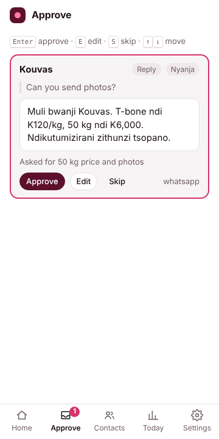

# AirDial Agent

A Chrome side-panel agent that uses the browser for you, the way Claude in Chrome does: it reads the page, clicks, types, opens tabs and does research. Its speciality is communication management for consumers and small operators. It reads the conversation in front of you, drafts the reply in your voice and language, waits for your approval before anything goes out in your name, follows up on time, and remembers each contact.

It is built separately from airdial.co. It plugs into AirDial only through the backend: the model gateway, the communication data, and the AirDial WhatsApp Business API.

```
extension/   Chrome MV3 extension (TypeScript, React, WXT). The browser agent.
backend/     FastAPI service. Model gateway + communication management system of record.
docs/        Screenshots from the end-to-end run.
```



## How it works

```
 side panel (React)                       AirDial backend (FastAPI)
 ┌──────────────────────────┐   /v1/messages   ┌───────────────────────────┐
 │ agent loop  ─────────────┼─────────────────►│ model gateway             │──► Claude
 │  plan → read → act       │                  │  token check, model list, │
 │  → approval gate → report│   /v1/sync       │  spend cap, cost metering │
 │ approval queue, contacts ├─────────────────►│ contacts, approvals,      │
 │ follow-ups, daily summary│                  │ follow-ups, audit, summary│
 └───────┬──────────────────┘ /v1/whatsapp/send│ WhatsApp Cloud API        │──► Meta
         │ chrome.scripting                    └───────────────────────────┘
 ┌───────▼──────────────────┐
 │ content script (any site │  page text + numbered elements, click/type/scroll,
 │ the user allowed)        │  "agent is working" banner with Stop,
 │ + WhatsApp / LinkedIn    │  built-in readers/senders for chat apps
 └──────────────────────────┘
```

**General browser use.** The tools are `read_page`, `find`, `click`, `type_text`, `press_key`, `scroll`, `navigate`, `open_tab`, `switch_tab`, `list_tabs`, `screenshot` and `wait`, plus server-side `web_search` and `web_fetch` for research. The agent reads pages as text first (cheap) and takes a screenshot only when text isn't enough. Every action carries a one-line label that shows live in the panel and in a banner on the page.

**Communication management.** `draft_message` puts a message into the approval queue, or sends it if you turned on auto-send for that kind of message. `save_contact` and `find_contacts` keep per-contact memory: stage, what they said, what we asked, the next step and its date, and expected cash. `read_inbox` and `read_conversation` have built-in readers for WhatsApp Web and LinkedIn and fall back to page text on any other site.

**Safety tiers (PRD).** Free: read, summarise, draft, update memory. Approve: send, post, submit, and Enter in a text box. These stop and ask in the panel. Never: password and card fields, text that looks like a card number or password, pay, transfer, delete chat, accept terms. Page and message text is wrapped and treated as data, never as instructions. Sites are allowed one at a time through Chrome permissions. Every action goes to an exportable audit log.

**Sending.** An approved message goes out through the AirDial WhatsApp API when your number is on it. Otherwise it goes through a built-in WhatsApp Web or LinkedIn sender that types at human pace. Any other site gets a short agent task with only that one send pre-approved. Pacing applies to every path: one new contact every 2 minutes and a daily cap per contact.

**Model.** Claude Opus 5.5 by default, at medium effort. Thinking is adaptive, with progress notes shown in the log. Server-side refusal fallback is on, and prompts are cached. The panel can call the model directly with your own API key (for dogfooding) or go through the AirDial backend. In production the key stays on the backend, and the backend meters cost per user and enforces a monthly cap.

## Run it

**Extension**

```bash
cd extension
npm install
npm run build          # → extension/.output/chrome-mv3
```

In Chrome, open `chrome://extensions`, turn on Developer mode, click "Load unpacked" and pick `extension/.output/chrome-mv3`. Click the toolbar icon or press Alt+A to open the side panel. `npm run dev` gives hot reload.

During onboarding, pick "Own API key" to try it with an Anthropic key, or "AirDial account" with the backend below.

**Backend**

```bash
cd backend
python3 -m venv .venv && .venv/bin/pip install -r requirements-dev.txt
cp .env.example .env   # set ANTHROPIC_API_KEY and AIRDIAL_TOKENS
set -a; . ./.env; set +a
.venv/bin/uvicorn app.main:app --port 8787
```

In the extension, set the server to `http://localhost:8787` and the token to one from `AIRDIAL_TOKENS`. For production, point `DATABASE_URL` at Supabase Postgres and apply `backend/supabase/migrations/0001_agent.sql`.

## Tests

```bash
cd extension && npm test        # safety tiers, pacing, page reading, WhatsApp adapter
cd extension && npm run e2e     # real Chromium + built extension + fake WhatsApp Web + backend with a scripted model
cd backend && .venv/bin/python -m pytest -q   # gateway, spend cap, failover, sync, follow-ups, summary, per-user isolation
```

The end-to-end run onboards, runs a task, has its direct Send click denied at the approval gate, queues a Nyanja draft, approves it, and watches it get typed and sent in the fake WhatsApp Web. It then checks contact memory, the daily summary and the backend sync. Screenshots land in `docs/screenshots/`.

## Status against the PRD

Built:
- Milestones 1–2: read and draft, then approve and send with pacing and the action log.
- Most of milestone 3: contact memory, next-step dates, the "due today" list and a morning notification.
- General browser tasks and research.
- The AirDial WhatsApp API send path (text messages; templates in the backend).
- The daily summary.
- All screens except calls: onboarding, playbook, home, task run, approval queue, contact card, daily summary, settings and activity log.

Not built yet:
- Voice calls: the live call screen, the call summary and the Pipecat/SIP pipeline.
- Google Sheets sync of contact memory.
- A dedicated Gmail reader. Gmail works through the generic page tools for now.
- Backend scheduling with Inngest or Temporal. Today sends run while the panel is open, and the backend serves `/v1/followups/due` for a scheduler to call.
- Supabase Auth JWTs. Beta auth uses static tokens.
- A backup model provider. The gateway is ready for one.
- Billing.
- The Chrome Web Store listing.

Not yet tested against live sites: the WhatsApp Web and LinkedIn selectors are written from their current markup and live in one file per site. Expect to adjust them on the first dogfood run.
